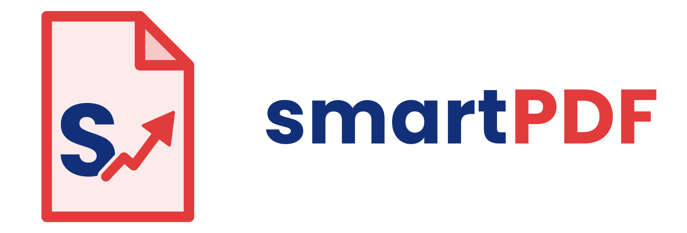

<p align="center"></p>

# smartPDF

轻巧的 PDF 阅读和编辑工具。整个程序就是一个 HTML 文件（`smartpdf.html`），用浏览器直接打开就能用，也可以装成 Windows 软件。

A lightweight PDF viewer and editor in a single HTML file, with a small Windows installer. The UI switches between Chinese and English.

## 下载

Windows 安装包在 [Releases](../../releases) 页面（约 2 MB，不需要管理员权限）。安装包没有数字签名，Windows 可能提示「已保护你的电脑」，点「更多信息」→「仍要运行」即可。

## 功能

- 阅读：缩放、目录、搜索、选取和复制文字、链接、有密码的 PDF
- 编辑：修改原文字，加文字、日期、勾选、签名、印章、骑缝章、图片、高亮、画笔、方框，白色遮盖和永久涂黑，页码、水印
- 页面：旋转、删除、调整顺序，合并 PDF，拆分 PDF（每页一份、每 N 页一份、按页码分组，或按发票号码自动拆分和排序），对比两份文件的文字差异
- 保存：Ctrl+S 直接存回原文件，Ctrl+Shift+S 另存为
- 转换：PDF 转 JPG / PNG、PDF 转 Word（只含文字）、PDF 转文字、图片转 PDF
- 打印、中英文切换

## 文件结构

| 路径 | 内容 |
|---|---|
| `smartpdf.html` | 整个程序（内含 pdf.js 3.11、pdf-lib、fontkit、JSZip） |
| `desktop/` | Windows 桌面版外壳（Neutralino）和安装包脚本 |
| `brand/` | logo 和图标 |

## 打包 Windows 安装包

```bash
sudo apt-get install nsis   # 需要 Node 18+ 和 NSIS
desktop/build.sh            # 输出 desktop/out/smartPDF-Setup-<版本>.exe
```

在 GitHub 的 Actions 页面运行 Release（或推送 `v*` 标签），会自动打包，并按这个版本号建立 Release、附上安装包。

桌面版说明：
- 用 Neutralino 的 chrome 模式，窗口由电脑自带的 Edge 以 `--app` 方式显示（v2.0 用 WebView2，在部分电脑上窗口出不来，v2.0.1 起改掉）。
- 网页在 `http://127.0.0.1:<端口>` 打开，程序检测到后载入 `js/neutralino.js`，用它读写本机文件和保存设置。
- 安装到 `%LOCALAPPDATA%\Programs\smartPDF`，会出现在 PDF 的「打开方式」里。
